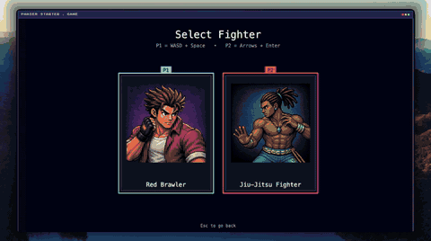

<div align="center">

# 🥊 Vibe Fighter

### An original 2D arcade fighter



<br>


Made by Sekip Hayit

  


</div>

---

This repo is the **source for the main game**: menu → mode select →
stage select → character select → match, with per-frame hitbox combat, six
punch and kick strengths, throws, crouching, jump-over collision, motion-input
specials, blocking, meter supers, best-of-3 rounds, and a group camera. The
15-fighter roster battles across 10 selectable stages. The game includes 1 vs
CPU, Arcade, and a character-by-character Training Room.

>
> **→ Build the whole thing step by step

## Run it

```bash
npm install
npm run dev        # http://localhost:5173
npm run build      # type-check + production build to /dist
```

The game is played by one local player against the CPU. During a match, P1 moves with WASD
and attacks with `I/O/P` (light/medium/heavy punch) and `K/L/;`
(light/medium/heavy kick). Press `U` to throw, `C` to block, or `V` for the
meter super. Motion specials use directions relative to the way your fighter
faces: `down, forward + punch` for Hadoken; `down, back + punch` for Shoryuken;
and `down, forward + kick` for Tatsumaki. Diagonal inputs also work. On
touchscreen devices, the on-screen pad and attack buttons are enabled.

## What's inside

- **Full game flow** — splash → menu → 1vCPU → stage → character select →
  best-of-3 versus match → rematch or menu.
- **Cross-platform groundwork** — installable web app manifest, offline app
  shell, Android Capacitor project, and touch controls on coarse-pointer devices.
- **Stages** — 10 selectable fighting backgrounds, browsed in the two-card stage
  carousel.
- **Real combat** — per-frame hit / hurt / **guard** boxes, six attack strengths,
  crouching, throws, hitstun, knockback, and fighter body collision that allows
  jump-overs.
- **Geometric blocking** — high/low coverage emerges from guard-box overlap, not
  height labels.
- **Rounds & camera** — first-to-2 rounds, a 60s round timer, and a group camera
  that clamps both fighters to the screen edges.
- **HUD & specials** — UI-atlas health bars and portraits, a meter economy,
  three motion-command specials (Hadoken, Shoryuken, Tatsumaki), and meter
  supers with a cut-in.
- **15 original fighters** — character portraits, action sprite sheets, distinct
  special move sets, stats, and Training Room command cards.
- **Arcade and Training modes** — complete the CPU ladder or browse each
  fighter’s three motion specials and meter super.

## Android build

After building the web game, sync it to the native Android project with
`npm run android:sync`. Open the `android/` project in Android Studio to create
a signed Play Store release bundle. A release signing key is intentionally kept
outside this source tree; local debug APKs can be built with Gradle. On desktop,
run `npm run dev` for local play or install the PWA from a supported browser.
`npm run android:open` opens the native project when Android Studio is installed.

## What's *not* in this repo

## Developer tools

The debug shell includes two live authoring tools:

- **Character Gym** — select a fighter and animation, inspect individual
  frames, and adjust visual, collision, hit, attack, and guard bounds with
  translate and scale controls. Save the selected frame or all edits to the
  local configuration.
- **Fighter Playground** — tune movement and combat stats against a training
  dummy, test attacks and motion specials, and display collision / attack bounds.

Open the app with `?shell=debug` (for example,
`http://localhost:5173/?shell=debug`) and use **Open Character Gym** or
**Open Fighter Playground** in the debug console. Playground controls are
`A/D` move, `W` jump, `S` crouch, `C` block, `I/O/P` punches, `K/L/;` kicks,
`U` throw, `V` super, and the same direction-plus-attack motions listed above.

<div align="center">


</div>
